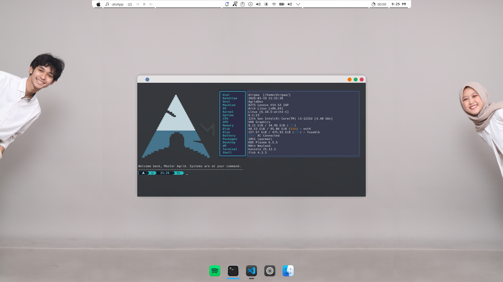

# Fastfetch Preset
<h3> Welcome to my fastfetch config presets😁</h3>

[Fastfetch](https://github.com/fastfetch-cli/fastfetch) is a tool for fetching system info and displaying it in a nice way.  
This repo is just a collection of my personal Fastfetch configs that I use on [Arch Linux](https://archlinux.org/).

✨Feel free to copy, modify, or clone the whole repo.

Nothing fancy here — just presets I use daily.  
Clean, simple, and looks nice in the terminal.👌



## Requirements⚙️
- fastfetch (recommended: latest version)
- A terminal with color support
- Nerd Font (optional, for better icon rendering)

## Installation🛠️
```bash
# generate default config if it doesn't exist
fastfetch --gen-config

# clone the repo everywhere you want (you can delete it after copying the preset)
git clone https://github.com/dirgaydtm/fastfetch-presets

# go to the folder
cd fastfetch-presets/presets

# copy the preset you want
cp <preset-name>.jsonc ~/.config/fastfetch/config.jsonc

# run fastfetch to see the changes
fastfetch
```